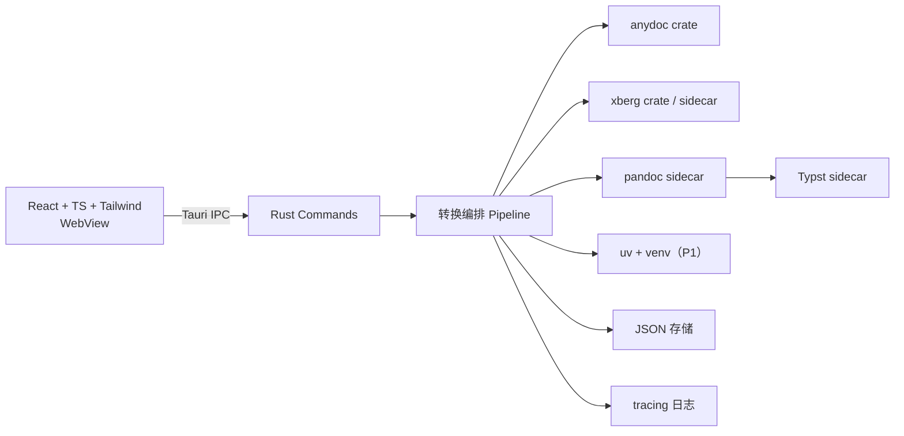

# DullDoc 技术选型（S6）

> 阶段：S6 · 技术选型探讨
> 版本：v1.0
> 日期：2026-11-18
> 状态：**已确认（v1.0）；S6-1/2/3/4 通过，S6-5/6 待完成**
> 上游文档：`docs/superpowers/需求文档.md`（v1.6）、`docs/superpowers/软件功能设计说明.md`（v1.6）
> 说明：本文只确定技术方案与验证门槛，不进入编码；S7 再拆 change。

---

## 1. 结论摘要

| 层 | 选型 | 理由 |
| --- | --- | --- |
| 应用壳 | Tauri 2 + Rust stable **1.99.1**（最低 1.99） | xberg 1.4.0 要求 Rust 1.99；anydoc 1.88、Typst 1.92 均满足 |
| 前端 | **React 19 + TypeScript + Vite + Tailwind CSS 4** | 生态成熟；Tailwind 用 token 主题映射 Proofing Desk，不写任意色值 |
| 组件策略 | 原生 `<dialog>` / `<select>` + 自定义 token 组件 | 与高保真原型一致，避免重型 UI 套件覆盖设计语言 |
| 状态 | React Context + `useReducer`；IPC 边界用 Zod 校验 | MVP 状态规模小；不引入额外全局状态库 |
| 数据 | `~/.dull_doc` 下 JSON 原子写入；**不引入数据库** | 设置、预设、50 条历史规模小；临时文件 + rename |
| Office / 文本 PDF | **anydoc 0.2.4**（Rust crate） | MIT；14+ 格式 → GFM；无 OCR，速度快 |
| OCR / 复杂 PDF | **xberg 1.4.0** + `paddle-ocr-ort` | MIT；ONNX 中文 OCR 1.58s/页；不误用旧 `kreuzberg` |
| 标记语言导出 | **pandoc 3.8.3** sidecar | DOCX / HTML / EPUB / Typst 输出；GPL 合规分发 |
| Markdown → PDF | **pandoc → Typst 0.15.1 → PDF** | 用户已确认 MVP 立即接入 Typst；避免 LaTeX |
| PDF → Word | **PDF → Markdown → DOCX**（anydoc/xberg + pandoc） | 不分发 pdf2docx，规避 PyMuPDF AGPL |
| Python 引擎 | **uv 0.13.9**（`tools/macos/uv/uv`）；按需下载 Python，安装前显式确认 | 用户已确认按需下载；不依赖系统 Python，不静默下载 |
| 打包 | macOS arm64 `.app` + `.dmg`；sidecar 预签名后公证 | macOS 15 对嵌套二进制校验严格 |
| 测试 | Rust 集成 + `example/` 黄金样本；Playwright UI；macOS 真机冒烟 | 覆盖真实样本与打包链路 |

**已确认决策**

1. Markdown → PDF：立即接入 Typst，不用 WebView 打印或 LaTeX 作为主路径。
2. PDF → Word：不打包 pdf2docx，走 PDF → Markdown → DOCX。
3. Python 运行时：由 uv 按需下载 Python；下载前提示体积、版本与来源，失败可重试。
4. 前端：React + TypeScript + Vite + Tailwind CSS。

---

## 2. 环境与版本矩阵

本机已验证：

| 工具 / 库 | 版本 | 说明 |
| --- | --- | --- |
| macOS | Darwin 24.5.0（Apple Silicon） | 首发目标 |
| Rust / Cargo | 1.99.1 | 满足 xberg 1.99 MSRV |
| Node.js | 22.23.3 | 前端构建 |
| pnpm | 12.14.0 | 包管理 |
| pandoc | 3.8.3 | 已安装；支持 `typst` 输入与输出格式 |
| uv | 0.13.9 | 项目内 `tools/macos/uv/uv`；用于 P1 Python 引擎 |
| anydoc | 0.2.4 | crates.io；MIT；MSRV 1.88 |
| xberg | 1.4.0 | crates.io；MIT；MSRV 1.99 |
| Typst | 0.15.1 | 已安装到 `tools/macos/typst/typst`；Apache-2.0；MSRV 1.92 |
| Python | 3.12.16（uv 托管） | `UV_PYTHON_INSTALL_DIR` 隔离安装；**不依赖**系统 Python |

约束：

- `rust-toolchain.toml` 固定 **1.99.1**，避免 xberg 的 MSRV 漂移。
- 所有依赖锁定精确版本与 `Cargo.lock`；升级需跑完整引擎回归。
- Typst 以 sidecar 形式分发；当前 spike 使用项目内 `tools/macos/typst/typst`。

---

## 3. 系统架构



进程边界：

- WebView 只负责界面与任务展示，不直接访问文件系统。
- Rust 后端负责文件选择、路径校验、引擎调用、任务状态、取消与日志。
- 外部程序一律以参数数组调用，不经过 shell。
- 每个任务持有 `CancellationToken`；取消时终止子进程并清理临时目录。

---

## 4. 前端方案

### 4.1 框架与构建

- **React 19 + TypeScript + Vite**。
- 路由：React Router，或单层页面状态；MVP 四页可用轻量状态切换，避免为四个页面引入复杂路由。建议先用单层 `currentPage` 状态，后续需要深链接再引入 React Router。
- 国际化：`i18next` + `react-i18next`；中英文 JSON 字典，默认中文，切换不重启。
- 校验：`zod` 只用于 IPC 入参与设置/预设/历史文件结构校验，不引入表单库。
- 状态：`useReducer` + Context 管理任务队列、筛选、主题/语言；转换进度通过 Tauri Channel/事件推送。

### 4.2 Tailwind 与设计 token

- Tailwind CSS 4 + `@tailwindcss/vite`；在 `@theme` 中映射 Proofing Desk token：
  - `--color-paper`、`--color-ink`、`--color-proof-red`、`--color-fix-blue`、`--color-success`。
  - 浅色/深色通过 `html[data-theme]` 与 CSS 变量切换，不在组件里写 hex。
- **禁止** `bg-[#xxxxxx]`、任意间距与任意字号；只使用 token 对应的 utility。
- 原生 `<dialog>` 继续用于历史详情、方向矩阵、PDF 预检、清空确认；焦点返回与 Esc 行为由浏览器保证。
- 组件目录：`Button`、`Input`、`Select`、`Switch`、`Badge`、`Card`、`Dialog`、`FileIcon`、`Progress`、`ErrorCard`、`SuccessCard`。
- 原型中的 12px/13px 字号与 8pt 间距进入 token；不得为还原截图写一次性样式。

### 4.3 可访问性

- 键盘完成主流程；焦点环 2px 修正蓝；对话框焦点陷阱与返回。
- 中英文切换不截断；长英文标签允许换行。
- 状态不只靠颜色：文字 + 图标/边框。
- 支持 `prefers-reduced-motion`；动效 ≤ 240ms。

---

## 5. Rust 后端

### 5.1 依赖

- `tauri` 2、`tokio`、`serde` / `serde_json`、`thiserror` / `anyhow`。
- `tracing` + `tracing-appender`（日志）、`tokio-util`（CancellationToken）。
- `zod` 对应的 Rust 侧用 `serde` + `schemars` 或手写校验。
- `sha2` / `blake3`（输入哈希）、`uuid`（任务 ID）、`keyring`（P1 密钥）。
- `dunce` 或 `std::fs::canonicalize` + 自写边界检查。

### 5.2 模块划分

```
src-tauri/
  src/
    commands/       # Tauri commands：转换、取消、历史、设置、引擎
    pipeline/       # 路由、预检、清洗、切块、产物写入
    engines/        # anydoc、xberg、pandoc、typst、uv 适配器
    storage/        # JSON 原子读写、schema 版本、历史裁剪
    security/       # 路径校验、进程参数、哈希
    logging/        # tracing、脱敏、诊断包
    state/          # AppState、任务表、取消令牌
```

### 5.3 IPC

- 命令：`start_conversion`、`cancel_task`、`get_settings`、`save_settings`、`list_history`、`clear_history`、`list_engines`、`install_runtime`。
- 进度：`task://progress` 事件，字段 `task_id / stage / current / total / percent / message`；1 秒节流。
- 完成/失败：`task://completed`、`task://failed`，带错误码与可复制诊断。
- 批量：每个文件独立 task；队列并发由 Rust 控制，前端只展示。

---

## 6. 引擎接入

### 6.1 anydoc

- 依赖：`anydoc = "=0.2.4"`。
- 输入：doc/docx/odt/rtf/epub/pdf/ppt/pptx/xls/xlsx/csv 等。
- 输出：GFM。
- 限制：**无 OCR**；图片型 PDF 返回 `NeedsOcr`，必须路由 xberg。
- 验证：`example/` docx 期望 49 标题；xlsx 期望 1048 表格行；PDF 封面页触发 OCR 分支。

### 6.2 xberg

- 依赖：`xberg = "=1.4.0"`；不使用旧 `kreuzberg` 4.x（Elastic-2.0）。
- 初始 feature 集：`formats-no-heic`、`tokio-runtime`、`paddle-ocr-ort`；按需增加 `chunking` / `layout-detection`。
- **OCR 后端用 `paddle-ocr-ort`（ONNX Runtime），不用 `paddle-ocr-tract`**：tract 在本机 1 页中文扫描件约 30.4s，ONNX 约 1.58s；两者二进制体积接近（101MB vs 104MB）。
- 决策点（spike）：优先尝试 **crate 嵌入**；若二进制体积、编译时间或 native 依赖不可接受，改为 **xberg-cli sidecar**。
- 模型：必须显式管理模型目录与下载确认；禁止运行时静默联网。spike 已观察到：`HF_ENDPOINT=https://hf-mirror.com` 时因缺 ETag 下载失败；改用官方 `https://huggingface.co` 后成功，缓存约 36MB。PP-OCRv6 small det/rec 约 9.9MB + 21.2MB；建议随包预置并设置本地模型目录，或首次使用经确认后下载并校验哈希。正式实现不得依赖 hf-mirror 的默认行为。
- OCR 验证：50 页 PDF 封面页、扫描 PDF、中文表格；记录置信度与耗时。

### 6.3 pandoc

- 版本 3.8.3；sidecar `pandoc-aarch64-apple-darwin`。
- 用途：Markdown → DOCX / HTML / EPUB / Typst。
- 调用：参数数组；禁止 shell 拼接；超时与退出码映射错误码。
- GPL 合规：附 LICENSE、源码获取说明；不静态链接。

### 6.4 Typst

- 版本 0.15.1；sidecar `typst-aarch64-apple-darwin`。
- 管线：`pandoc -s -f markdown -t typst` → `typst compile`。
- **必须带 `-s`**：pandoc 3.8.3 的 Typst writer 会输出 `#horizontalrule`，该宏只在 standalone 模板中定义；不带 `-s` 时 Typst 0.15.1 报 `unknown variable: horizontalrule`。升级到 pandoc ≥ 3.10.1 后可改用原生 `#divider()`。
- 字体（已确认）：
  - 先用 macOS 系统字体（PingFang SC / Songti SC）验证中文分页，不增加安装包体积。
  - spike 若发现跨机器不一致、缺字或分页异常，再 bundle Noto Sans/Serif CJK SC（OFL），通过 `--font-path` 指定。
- 图片：Markdown 相对路径 → Typst 资源路径；输出 PDF 前校验图片存在。
- 失败：`E_PDF_RENDERER_MISSING` / `E_PDF_COMPILE_FAILED`，阻止并给下一步；不静默降级。

### 6.5 Python 引擎（P1）

- uv 0.13.9 sidecar；`~/.dull_doc/runtimes/<engine>/.venv`；`UV_PYTHON_INSTALL_DIR` 指向应用数据目录。
- **按需下载 Python**：首次安装 PaddleOCR / Marker 前弹出确认，显示 Python 版本、包体积、来源与哈希；用户确认后才联网。
- 不依赖系统 Python；不静默下载模型；安装完成后记录版本与哈希。
- 安装命令固定加 `--no-bin`，避免向 `~/.local/bin` 写入 Python 可执行文件；`UV_PYTHON_INSTALL_DIR` 必须在 install 与 venv 两条命令中保持一致。
- PaddleOCR：优先使用 xberg 的 `paddle-ocr-ort`；spike 实测 Python PaddleOCR 安装后 `.venv` 约 795MB，仅作 P1 回退，不默认启用。
- Marker：仅 P1，用户显式安装；代码 Apache-2.0，但模型权重为 OpenRAIL-M，含营收与竞品限制；不随包分发。
- pdf2docx：**不分发、不默认安装**；仅作为用户自行安装的外部工具提示，且标注 PyMuPDF AGPL 风险。

### 6.6 PDF → Word

- 主路径：PDF → Markdown（anydoc 文本型 / xberg OCR）→ pandoc DOCX。
- 不打包 pdf2docx；因此复杂版式的 PDF→Word 保真度有限，需在方向矩阵标注质量风险。
- 质量门槛：`example/` 50 页 PDF 产出 DOCX，标题/表格/图片可打开；低于门槛时提示改用 Markdown 或外部工具。

---

## 7. 存储设计

- 根目录：`~/.dull_doc/`。
- 文件：
  - `settings.json`：语言、主题、输出目录、图片模式、覆盖策略、语料包全局默认。
  - `presets.json`：内置预设版本 + 用户预设。
  - `history.json`：最近 50 条（可配置），只存路径、参数、方向、引擎、哈希、结果摘要。
  - `logs/`、`tmp/`、`runtimes/`。
- 写入：临时文件 + `fsync` + `rename`；进程级文件锁；schema `version` 字段；迁移函数。
- 不复制源文件/产物；历史清空不删除输出。
- 不引入数据库；若后续任务并发/查询复杂化，再评估 SQLite。

---

## 8. 安全

- 外部命令：`Command::new(bin).args([...])`；禁止 `sh -c`、禁止拼接用户路径。
- 路径：canonicalize；限制在用户选择的输入根与输出根内；拒绝符号链接逃逸。
- 文件权限：只读输入、只写输出与 `~/.dull_doc` 临时目录。
- 密钥：P1 云服务才需要；存 macOS Keychain；不写日志、不入仓库。
- 日志：`tracing` 结构化字段；不记录文件正文、密钥、完整 token；诊断包脱敏。
- Tauri capabilities：最小权限；默认无 HTTP 权限；云功能需显式开启并二次确认。
- 子进程：超时、退出码、stderr 截断；失败保留临时产物但可清理。

---

## 9. 打包与分发

- 目标：macOS Apple Silicon arm64；`.app` + `.dmg`。
- sidecar：`pandoc`、`typst`、`uv`，可能还有 `xberg-cli`；按 Tauri `externalBin` 命名。
- 签名顺序（由内到外）：
  1. 嵌套 dylib / 模型工具；
  2. 每个 sidecar：`codesign --force --options runtime --timestamp --entitlements ...`；
  3. 主 app；
  4. `.app` 公证 + staple；
  5. `.dmg` 单独公证 + staple。
- entitlements：主 app 最小化；Python 相关 sidecar 单独 plist，必要时 `allow-unsigned-executable-memory` / `disable-library-validation`。
- 验证：`codesign --verify --deep --strict`、`spctl -a -vvv`、`xcrun stapler validate`、Gatekeeper 真机安装。
- 不在 CI 中静默下载模型；发布包不含 P1 模型。

---

## 10. 测试策略

| 层 | 工具 | 范围 |
| --- | --- | --- |
| Rust 单元 | `cargo test` | 路由、路径安全、JSON schema、错误码、取消 |
| Rust 集成 | `cargo test` + `example/` | docx/xlsx/md/pdf 转换、OCR 回退、Typst 输出、黄金样本 |
| 前端组件 | Vitest + Testing Library | 表单、开关、对话框、i18n、状态卡 |
| 端到端 UI | Playwright（mock Tauri IPC） | 四页导航、空/加载/成功/失败/无权限、命令面板、主题/语言 |
| macOS 打包 | 脚本 + 真机 | 签名、公证、Gatekeeper、sidecar 启动 |
| 性能 | 基准记录 | 50 页 PDF、1048 行 xlsx、1074 行 md 的耗时/内存 |

黄金样本不比较绝对字节，比较结构化特征：标题数、表格行数、图片引用、错误码、chunk 数。

---

## 11. 许可矩阵

| 组件 | 许可 | 分发策略 |
| --- | --- | --- |
| anydoc | MIT | crate 嵌入 |
| xberg 1.4.0 | MIT | crate 或 sidecar；锁定 `xberg`，不用旧 `kreuzberg` |
| pandoc | GPL-2.0-or-later | 独立 sidecar；附许可证与源码获取说明 |
| Typst / typst-pdf | Apache-2.0 / MIT | sidecar；附 NOTICE |
| Tauri 2 | MIT / Apache-2.0 | 常规 |
| React / Vite / Tailwind | MIT | 常规 |
| uv | Apache-2.0 / MIT | sidecar；附 NOTICE |
| PaddleOCR | Apache-2.0 | P1；模型单独许可，不随包分发 |
| Marker | 代码 Apache-2.0；权重 OpenRAIL-M | P1；用户显式安装；显示营收/竞品限制 |
| pdf2docx | 代码 MIT；依赖 PyMuPDF AGPL-3.0 | **不分发、不默认安装** |
| Noto CJK（如引入） | OFL-1.1 | 附许可证；仅 bundle 字体文件 |

---

## 12. Spike 与验收门槛

| 编号 | Spike | 通过条件 |
| --- | --- | --- |
| S6-1 | anydoc 接入 | docx 49 标题；xlsx 1048 行；md 直通；PDF 封面页进入 OCR 分支 |
| S6-2 | xberg 接入 | 扫描 PDF OCR 可读；中文表格不崩；记录二进制体积与构建时间；离线可用 |
| S6-3 | Typst PDF | 20 页中文文档分页正确；标题/表格/图片完整；无缺字 |
| S6-4 | uv Python | 用户确认后下载 Python；创建 `.venv`；安装 PaddleOCR 成功；断网可识别失败；无静默网络 |
| S6-5 | macOS 打包 | sidecar 签名/公证通过；Gatekeeper 真机可启动；`.dmg` 通过 staple 验证 |
| S6-6 | PDF→Word | 50 页样本 DOCX 可打开；标题/表格/图片可辨认；记录质量分级 |

任一 spike 不达标时，回到本文更新选型，不直接进入 S7。

### 12.1 已执行 spike 记录（2026-11-18）

| 编号 | 状态 | 实测结果 |
| --- | --- | --- |
| S6-1 | **通过** | anydoc 0.2.4：docx 181ms / 49 标题；xlsx 26ms / 1048 表格行；PDF 封面页 `NeedsOcr { pages: [1], page_count: 50 }`；去掉封面后 1049ms / 14 标题 / 143 表格行；Markdown 不在 anydoc 支持范围（按设计直通，不送 anydoc） |
| S6-2 | **通过（需预置模型）** | `formats-no-heic`：47MB / 1m48s，PDF/docx/xlsx 3–5ms；`paddle-ocr-ort`：104.4MB / 2m12s，中文扫描页 ONNX OCR 1.58s、文本正确；`paddle-ocr-tract` 同页 30.4s，弃用；官方 HF 下载模型缓存 36MB，hf-mirror 因缺 ETag 失败，正式版需预置模型 |
| S6-3 | **通过（需 `-s`）** | pandoc 3.8.3 `-s -t typst` 生成 39,550 字节 / 1,217 行；Typst 0.15.1 编译为 691,194 字节 / 24 页 PDF；中文文本可提取，系统字体正常，表格与 ASCII 图可渲染；非 standalone 输出会因 `#horizontalrule` 失败 |
| S6-4 | **通过（体积需注意）** | 项目 uv 0.13.9 下载 CPython 3.12.16：24.1MB / 4.86s，安装 67MB；`.venv` 使用项目内 Python；`paddleocr 3.7.0` + `paddlepaddle 3.3.1` 安装 30s，venv **795MB**，CPU 导入正常；`UV_OFFLINE=1` 无缓存时下载失败、已有 Python 可离线建 venv、缓存包可离线安装 |
| S6-5 | 未开始 | 需 sidecar 预签名、公证与 Gatekeeper 真机验证 |
| S6-6 | **部分通过** | 去封面 PDF → anydoc Markdown（136,817 字节）→ pandoc DOCX（55,709 字节，14 段/18 表，zip 结构完整）；视觉保真与复杂表格质量待人工复核 |

**阶段判断**：S6-1、S6-2、S6-3、S6-4 通过；Python PaddleOCR 安装体积约 800MB，明显大于 xberg ONNX（约 140MB 含模型），因此 P1 仅按需启用。S6-5、S6-6 待完成。当前不进入 S7。

---

## 13. 风险与对策

| 风险 | 影响 | 对策 |
| --- | --- | --- |
| xberg 体积/构建复杂 | 编译慢、包体大 | spike 比较 crate vs sidecar；最小 feature；必要时拆 sidecar |
| xberg 模型静默联网 | 违反离线承诺 | 模型目录显式配置；网络审计；首次下载确认 |
| Typst 中文字体缺失 | PDF 缺字/方块 | 系统字体验证；必要时 bundle Noto CJK |
| pandoc GPL | 分发合规 | 独立进程 + 许可证 + 源码说明 |
| pdf2docx AGPL | 许可污染 | 不分发、不默认安装 |
| Marker 权重限制 | 商用限制 | 仅 P1 用户自装，展示许可 |
| macOS sidecar 公证 | 启动被 Gatekeeper 拦截 | 预签名、独立 entitlements、公证 `.app` 与 `.dmg` |
| uv 下载 Python | 首次使用依赖网络 | 显式确认、版本/哈希校验、失败可重试、离线缓存 |
| PDF→Word 质量 | 复杂版式不保真 | 方向矩阵标注限制；Markdown 优先；质量分级 |

---

## 14. 确认记录

- 2026-11-18：用户确认 Markdown→PDF 立即接入 Typst、PDF→Word 不分发 pdf2docx、uv 按需下载 Python、React + TypeScript + Vite + Tailwind CSS。
- 2026-11-18：用户确认 Typst 中文字体**先使用 macOS 系统字体**；spike 发现缺字或跨机器不一致时再 bundle Noto CJK。
- 2026-11-18：技术选型冻结为 **v1.0**；按顺序执行 S6-1 至 S6-6，spike 全部达标后再进入 S7 Change 规划。

---

## 15. 参考

- anydoc：<https://github.com/firecrawl/anydoc>
- xberg：<https://github.com/xberg-io/xberg>
- pandoc：<https://pandoc.org/>
- Typst：<https://github.com/typst/typst>
- uv：<https://github.com/astral-sh/uv>
- Tauri sidecar 公证问题：<https://github.com/tauri-apps/tauri/issues/11992>
- pdf2docx：<https://github.com/ArtifexSoftware/pdf2docx>
- Marker：<https://github.com/datalab-to/marker>
