# DullDoc 软件功能设计说明（S4）

> 阶段：S4 · 功能拆解 + MVP
> 版本：v1.0
> 日期：2026-11-18
> 状态：**已确认**（2026-11-18 用户确认）
> 上游文档：`docs/superpowers/需求文档.md`（v1.0，已确认）
> 下游文档：`docs/superpowers/UI设计规范.html`、`docs/superpowers/UI.html`（S5）
> 说明：本文档把 PRD 中的每条正式需求落到模块、功能与流程；排期为初步设计排期，S7 的 `CHANGE.md` 再拆为可执行 change。

---

## 1. 设计目标与优先级

### 1.1 设计目标

1. **一个工作台**：单文件、批量、语料包、历史、设置在同一个 macOS 应用内完成。
2. **引擎分层**：anydoc 快路径，xberg 负责 OCR/复杂表格与回退，PaddleOCR（P1）做中文 OCR 增强，pandoc 负责导出。
3. **保真与可解释**：每个文件显示引擎、参数、警告与错误；质量分级不承诺做不到的事。
4. **可复现**：输入哈希、引擎版本、预设、参数写入 manifest。
5. **组件化与 SDK 化**：UI 组件可复用；转换、清洗、切块、manifest、日志抽离为独立核心模块。

### 1.2 优先级定义

| 优先级 | 定义 | 典型内容 |
| --- | --- | --- |
| P0 | MVP 必须；缺一个就不能交付 | 单文件、批量、清洗、语料包、历史、设置、日志、xberg 回退 |
| P1 | MVP 之后紧随；影响效率或质量 | PaddleOCR、PDF 输出、监听文件夹、CLI、深色模式、质量对比 |
| P2 | 后续规划；当前只留接口 | Windows/Linux、平台直连、Finder 分享、表格修复增强 |

### 1.3 架构总览

```
┌──────────────────────────────────────────────────────────────┐
│ Tauri 2 WebView（前端）                                       │
│  页面：转换 / 批量 / 历史 / 设置                                │
│  组件：Button / Input / Select / Switch / Card / Table / ...   │
├──────────────────────────────────────────────────────────────┤
│ Tauri Commands / Events（Rust 后端）                           │
│  任务编排 · 文件系统 · 设置 · 历史 · 日志 · 诊断                 │
├──────────────────────────────────────────────────────────────┤
│ Core SDK（Rust）                                               │
│  engine_router · converter · cleaner · chunker · manifest     │
│  history · settings · logger · error                          │
├──────────────────────────────────────────────────────────────┤
│ 引擎层                                                         │
│  anydoc（crate） · xberg（crate/sidecar） · PaddleOCR（P1）     │
│  pandoc（sidecar） · Marker/MinerU（P1 备选）                   │
└──────────────────────────────────────────────────────────────┘
```

### 1.4 模块地图

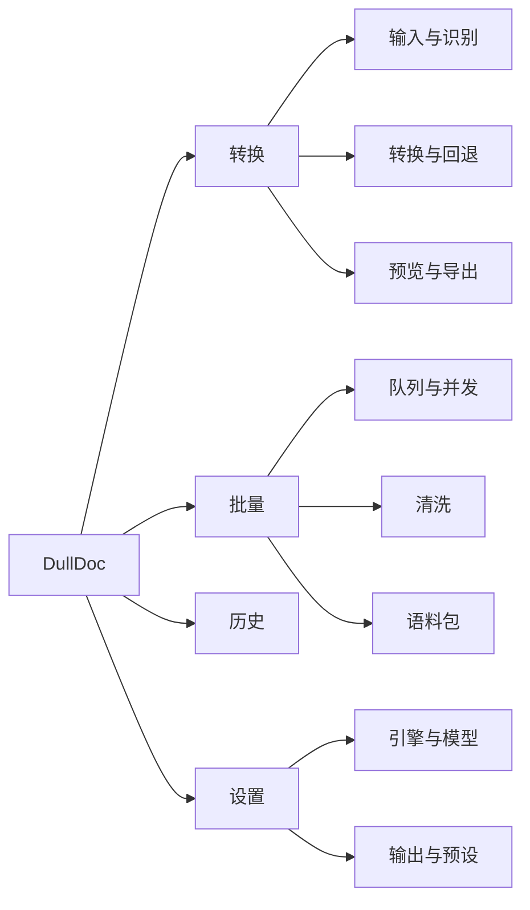

---

## 2. 模块与功能拆解

> 每行都有 `REQ-xxx`；`排期` 为 P0/P1/P2。三级功能用于表达更深层级。

### 2.1 全局与导航

| 一级功能 | 二级功能 | 三级功能 | 功能描述 | 对应需求编号 | 排期 |
| --- | --- | --- | --- | --- | --- |
| 应用外壳 | 主窗口 | 启动/恢复 | 原生窗口；首次启动创建应用数据目录；启动失败可复制诊断 | REQ-001 | P0 |
| 导航 | 侧边栏 | 四项一级菜单 | 转换、批量、历史、设置；键盘可切换 | REQ-002 | P0 |
| 输入 | 全局拖入 | 单文件/多文件/文件夹 | 单文件进转换；多文件/文件夹进批量；拖入高亮 | REQ-003 | P0 |
| 任务 | 全局状态 | 顶栏/通知 | 当前任务、进度、取消；完成/失败通知 | REQ-004 | P0 |
| 配置 | 设置持久化 | JSON 读写 | 设置写入本地 JSON；重启恢复；不存密钥明文 | REQ-005 | P0 |
| 诊断 | 日志与诊断 | 日志分级/导出 | 任务 ID、引擎、耗时、错误码；可导出脱敏诊断包 | REQ-006、REQ-074 | P0 |
| 运行 | 离线 | 零网络/显式云开关 | 默认不发起网络请求；云功能需显式开启与二次确认 | REQ-007、REQ-080 | P0 |
| 关于 | 版本与许可 | MIT/第三方 | 版本、许可、pandoc 源码获取方式 | REQ-008 | P0 |

### 2.2 转换：输入与识别

| 一级功能 | 二级功能 | 三级功能 | 功能描述 | 对应需求编号 | 排期 |
| --- | --- | --- | --- | --- | --- |
| 文件导入 | 文件选择 | 选择器/最近文件 | 支持文件选择器、拖拽、最近文件；拒绝目录 | REQ-010 | P0 |
| 文件导入 | 内容识别 | 字节识别/扩展名兜底 | 读字节判断格式；识别加密/损坏；扩展名仅兜底 | REQ-011 | P0 |
| 文件导入 | 文件信息 | 格式/大小/页数 | 显示格式、大小、PDF 页数、预计引擎与限制 | REQ-012 | P0 |
| 文件导入 | 权限 | 安全作用域书签 | macOS 文件夹授权；重启后仍可访问 | REQ-075 | P0 |

### 2.3 转换：引擎与回退

| 一级功能 | 二级功能 | 三级功能 | 功能描述 | 对应需求编号 | 排期 |
| --- | --- | --- | --- | --- | --- |
| 快速路径 | anydoc | Office/ODF/RTF/EPUB/CSV | 直接转 GFM；文本型 PDF 进入预检 | REQ-013 | P0 |
| 快速路径 | Markdown 直通 | 清洗/切块 | 不重新解析，仅清洗与切块 | REQ-013 | P0 |
| 格式兜底 | HTML/MHTML | pandoc | HTML → Markdown；异常提示 | REQ-013、REQ-024 | P0 |
| PDF | 页级预检 | 逐页文本检测 | 统计非空白字符；列出无文本页与占比 | REQ-014 | P0 |
| PDF | 无文本页策略 | skip/fail/ask | 单文件弹窗；批量预设；跳过页写 manifest | REQ-015 | P0 |
| OCR | 路由 | xberg → PaddleOCR → 降级 | xberg 优先；PaddleOCR（P1）中文增强；均不可用才跳过/失败 | REQ-016、REQ-098 | P0 |
| OCR | xberg 接入 | crate/sidecar | OCR、复杂表格、Markdown/HTML/JSON；模型管理 | REQ-097、REQ-099 | P0 |
| OCR | PaddleOCR 接入 | P1 组件 | 中文 OCR/PP-Structure；检测环境/引导安装 | REQ-101、REQ-102 | P1 |
| OCR | Marker/MinerU | P1 备选 | 高质量版面/OCR；检测环境 + 引导安装 | REQ-090 | P1 |
| 任务 | 进度与取消 | 阶段/百分比 | 识别→解析→清洗→切块→写入；可取消 | REQ-018 | P0 |
| 任务 | 错误与重试 | 错误码/下一步 | 错误码、原因、下一步；可重试 | REQ-019 | P0 |

### 2.4 转换：预览与导出

| 一级功能 | 二级功能 | 三级功能 | 功能描述 | 对应需求编号 | 排期 |
| --- | --- | --- | --- | --- | --- |
| 预览 | 渲染 | GFM 渲染 | 表格、代码、图片、公式；滚动流畅 | REQ-020 | P0 |
| 预览 | 源码 | 源码/复制/搜索 | 源码与保存文件一致 | REQ-021 | P0 |
| 预览 | 质量提示 | 差异/可疑表格 | 标出可疑表格、缺失标题、跳过页（P1） | REQ-022 | P1 |
| 保存 | Markdown | md + assets | 默认 assets/ 相对路径；可选 base64 | REQ-023、REQ-046 | P0 |
| 导出 | HTML | pandoc | 可选模板/CSS；失败给原因 | REQ-024 | P0 |
| 导出 | DOCX | pandoc | 保留标题/表格/图片 | REQ-025 | P0 |
| 导出 | EPUB | pandoc | 元数据可填 | REQ-026 | P0 |
| 导出 | PDF | Typst/WebView/LaTeX | P1 评估；MVP 不做 | REQ-091 | P1 |
| 导出 | 导出前检查 | pandoc/目录/图片 | 缺失时阻塞并给修复建议 | REQ-028 | P0 |
| 操作 | 打开/复制 | Finder/复制路径 | 打开输出目录、复制 Markdown | REQ-027 | P0 |

### 2.5 批量

| 一级功能 | 二级功能 | 三级功能 | 功能描述 | 对应需求编号 | 排期 |
| --- | --- | --- | --- | --- | --- |
| 输入 | 文件/文件夹 | 多选/递归/过滤 | 递扫；跳过隐藏文件与输出目录自身 | REQ-030、REQ-031 | P0 |
| 队列 | 列表 | 状态/引擎/耗时/警告 | 等待/转换/清洗/完成/失败/跳过 | REQ-032 | P0 |
| 并发 | 并发控制 | 默认/范围/内存 | 默认 min(4, CPU/2)，可配 1–8 | REQ-033 | P0 |
| 进度 | 总/单文件 | 取消/清理 | 取消停止调度；清理临时文件 | REQ-034 | P0 |
| 失败 | 重试/跳过 | 已存在策略 | 单文件重试；跳过/覆盖/重命名 | REQ-035 | P0 |
| 结果 | 汇总/报告 | JSON/CSV | 成功/跳过/失败计数；失败明细 | REQ-036 | P0 |
| 配置 | 预设 | 内置/复制 | 标准文档、表格清单、知识库 | REQ-039 | P0 |
| 自动化 | 监听文件夹 | P1 | 新增文件 5 秒内入队；可暂停 | REQ-037 | P1 |
| 自动化 | CLI | P1 | 与 GUI 共享核心；单文件/文件夹/预设/语料包 | REQ-038 | P1 |
| 自动化 | Finder/分享 | P1 | 右键「用 DullDoc 转换」 | REQ-093 | P1 |

### 2.6 清洗与规范化

| 一级功能 | 二级功能 | 三级功能 | 功能描述 | 对应需求编号 | 排期 |
| --- | --- | --- | --- | --- | --- |
| 规则 | 开关/预设 | 逐项 | 默认保守；每步可在预览对比 | REQ-040 | P0 |
| 页眉页脚 | 页码/重复行 | 规则识别 | 只删匹配到的页眉页脚与页码 | REQ-041 | P0 |
| 断行 | 中文断行/空段 | 代码块跳过 | 合并硬换行；压缩空行；代码块不变 | REQ-042 | P0 |
| 标题 | 层级/编号 | `5 . 1` → `5.1` | 清理标题内多余空格；层级连续 | REQ-043 | P0 |
| 中文 | CJK/标点/TOC | URL/代码/公式跳过 | CJK 间去空格；CJK 与 Latin 保留；点线清理 | REQ-044、REQ-047 | P0 |
| 表格 | 保护/分级 | A/B/C | 表格整块；列数校验；合并单元格降级/警告 | REQ-045 | P0 |
| 图片 | 资产策略 | assets/base64 | 命名可预测；hash 去重 | REQ-046 | P0 |
| 对比 | 清洗预览 | P1 | 原 Markdown 与清洗后并排/差异 | REQ-048 | P1 |

### 2.7 语料包

| 一级功能 | 二级功能 | 三级功能 | 功能描述 | 对应需求编号 | 排期 |
| --- | --- | --- | --- | --- | --- |
| 切块 | 标题/固定/超长 | 500–4000 字符 | 默认标题切；超长二次切；重叠 0–300 | REQ-050 | P0 |
| 切块 | 表格/父子块 | 表格整块 | 表格不拆；可选父子块 | REQ-051 | P0 |
| 元数据 | 字段 | 来源/章节/页码/hash | 每 chunk 最小元数据集 | REQ-052 | P0 |
| 产物 | chunks.jsonl | 每行 JSON | `id/text/metadata`；UTF-8；稳定 id | REQ-053 | P0 |
| 产物 | manifest.json | 文件/引擎/警告/总计 | 输入哈希、引擎版本、参数、跳过/OCR 页 | REQ-054 | P0 |
| 输出 | 目录/zip | 一包交付 | md、assets、chunks、manifest | REQ-055 | P0 |
| 校验 | JSONL/manifest/图片 | 输出后校验 | 失败给可定位错误 | REQ-058 | P0 |
| 优化 | 去重/token | P1 | 重复段落检测；token 统计 | REQ-056 | P1 |
| 集成 | 平台适配 | P2 | Dify/RAGFlow/向量库 | REQ-057、REQ-095 | P2 |

### 2.8 历史

| 一级功能 | 二级功能 | 三级功能 | 功能描述 | 对应需求编号 | 排期 |
| --- | --- | --- | --- | --- | --- |
| 列表 | 最近 50 条 | 时间/类型/状态 | 输出目录、输入数；重启保留 | REQ-060 | P0 |
| 详情 | 重跑/打开/参数 | 预设与引擎版本 | 重跑使用相同预设；打开输出 | REQ-061 | P0 |
| 清理 | 保留/清空 | 不删输出 | 可配置保留条数；不复制源文件/产物 | REQ-062 | P0 |

### 2.9 设置

| 一级功能 | 二级功能 | 三级功能 | 功能描述 | 对应需求编号 | 排期 |
| --- | --- | --- | --- | --- | --- |
| 通用 | 语言/主题/目录 | 中文优先 | 深色模式 P1；默认输出目录 | REQ-070 | P0 |
| 引擎 | 版本/路径/模型 | anydoc/xberg/PaddleOCR/pandoc | 版本检测、路径、模型状态、安装状态 | REQ-071、REQ-099 | P0 |
| 输出 | 图片/覆盖/语料 | assets/base64 | 默认跳过同名；可覆盖/重命名 | REQ-072 | P0 |
| 预设 | 管理 | 新建/编辑/复制/导入导出 | JSON 可分享 | REQ-073 | P0 |
| 日志 | 级别/保留/诊断 | 脱敏 | 打开日志目录；导出诊断包 | REQ-074 | P0 |
| 权限 | 文件夹访问 | 安全作用域 | 授权失败给系统设置引导 | REQ-075 | P0 |
| 更新 | 检查 | P1 | 手动检查；默认不联网 | REQ-076 | P1 |

### 2.10 多引擎与安全

| 一级功能 | 二级功能 | 三级功能 | 功能描述 | 对应需求编号 | 排期 |
| --- | --- | --- | --- | --- | --- |
| 引擎 | xberg | 接入/模型 | Rust crate 或 sidecar；OCR/表格/回退 | REQ-097 | P0 |
| 引擎 | 路由 | 优先级/回退 | anydoc → xberg → PaddleOCR（P1）→ skip/fail | REQ-098 | P0 |
| 引擎 | 模型管理 | 检测/引导 | 不静默下载；离线可用 | REQ-099 | P0 |
| 引擎 | 质量对比 | anydoc vs xberg | 导出对比报告；不改用户输出 | REQ-100 | P1 |
| 引擎 | PaddleOCR | 中文 OCR | PP-OCR/PP-Structure；可选 | REQ-101、REQ-102 | P1 |
| 引擎 | 插件化 | 统一接口 | `Engine` trait；可切换引擎 | REQ-092 | P1 |
| 安全 | 命令调用 | 参数数组/超时 | 禁止 shell 拼接；限制路径 | REQ-081 | P0 |
| 安全 | 密钥/脱敏 | 钥匙串/日志 | 不落盘、不入仓库 | REQ-082 | P0 |
| 安全 | 文件边界 | 只读输入/只写输出 | 防符号链接逃逸 | REQ-083 | P0 |
| 平台 | Windows/Linux | P2 | macOS 稳定后扩展 | REQ-094 | P2 |
| 表格 | 修复增强 | P2 | 合并单元格/跨页/表格内公式 | REQ-096 | P2 |

---

## 3. 功能流程

### 3.1 单文件转换流程

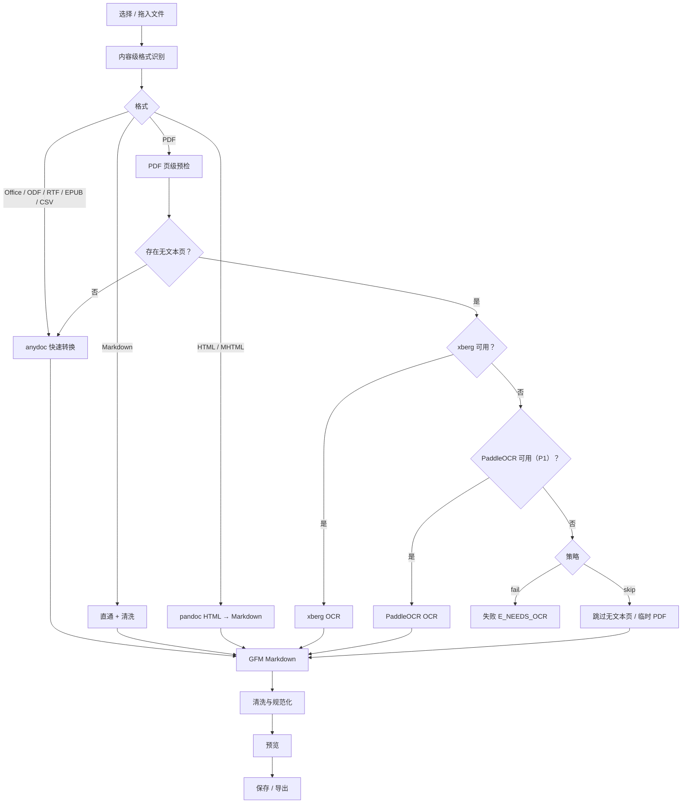

**文字说明**：文件先做内容级识别（REQ-011）。Office/ODF/RTF/EPUB/CSV 直接走 anydoc（REQ-013）；Markdown 直通并清洗；HTML/MHTML 交 pandoc；PDF 先做页级预检（REQ-014）。存在无文本页时，优先 xberg OCR（REQ-097/098），其次 PaddleOCR（P1，REQ-101/102），两者不可用才按 skip/fail/ask 策略处理（REQ-015/016）。所有路径最终汇入 GFM，再清洗、预览、保存或导出（REQ-020~028）。

### 3.2 PDF 预检与 OCR 回退流程

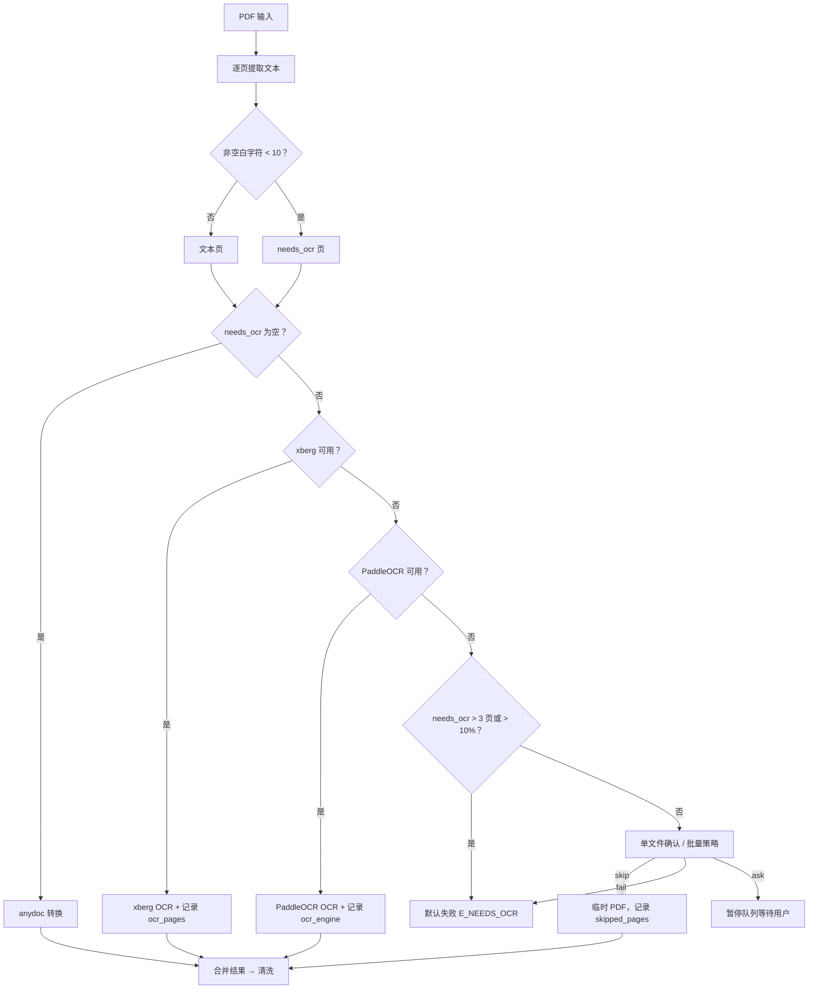

**文字说明**：预检阈值固定为「非空白字符 < 10」（REQ-014）。优先 OCR，不静默丢页；只有当 OCR 均不可用且页数/占比不高时才允许跳过（REQ-015）。所有跳过页、OCR 页与实际引擎写入 manifest（REQ-054）。页数超过阈值时默认失败，避免用户误以为转换完整（REQ-016）。

### 3.3 批量转换流程

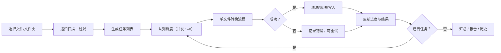

**文字说明**：批量复用单文件流程（REQ-030~036）。调度器按并发上限取任务；失败进入重试队列，不阻塞其他文件。默认跳过已存在输出（REQ-035）。完成后生成汇总与报告（REQ-036），并写入历史（REQ-060）。

### 3.4 清洗流程

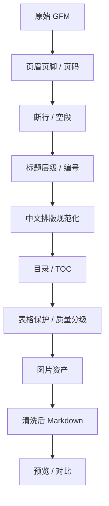

**文字说明**：清洗按固定顺序执行，避免规则互相破坏（REQ-040~047）。所有规则可单独关闭；代码块、公式、URL 不参与 CJK 空格处理（REQ-044）。表格质量分为 A/B/C，C 级给出明确警告（REQ-045）。P1 提供原/清洗后对比（REQ-048）。

### 3.5 语料包流程

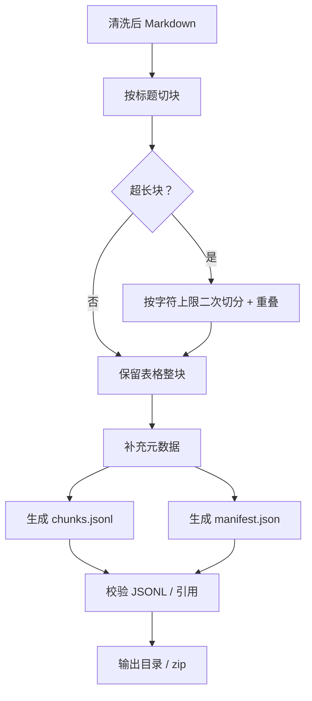

**文字说明**：默认按 H1–H3 切块，表格整块保留（REQ-050/051）。元数据含来源、章节、页码、hash、引擎与参数（REQ-052）。输出前校验 JSONL、manifest 与图片引用（REQ-058）。P1 增加去重与 token 统计（REQ-056）。

### 3.6 失败处理与重试流程

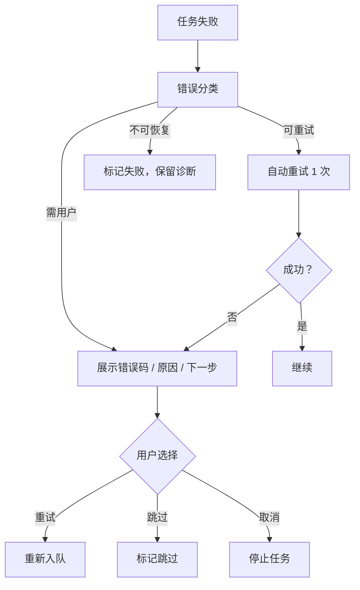

**文字说明**：错误码统一走 PRD 6.6 表（REQ-019）。可重试错误自动重试一次；权限、加密、扫描件等需用户处理。批量失败不阻塞其他文件，失败明细可导出（REQ-036）。

---

## 4. 页面流程

### 4.1 全局导航

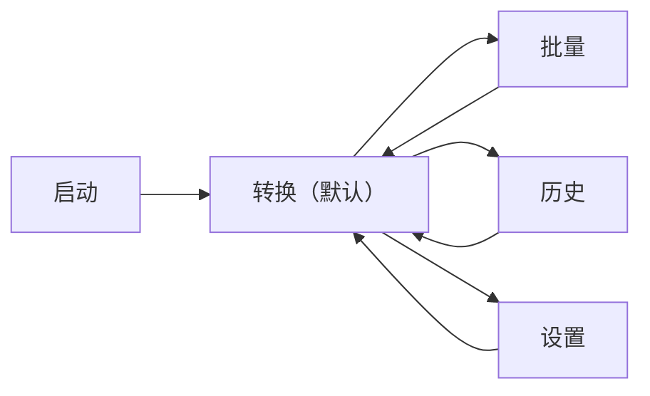

**文字说明**：四页平级，状态保持（REQ-002）。任意页面拖入文件按数量路由（REQ-003）。

### 4.2 单文件页面

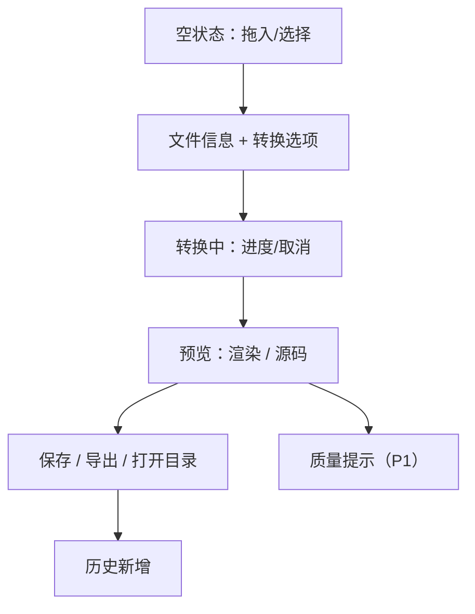

### 4.3 批量页面

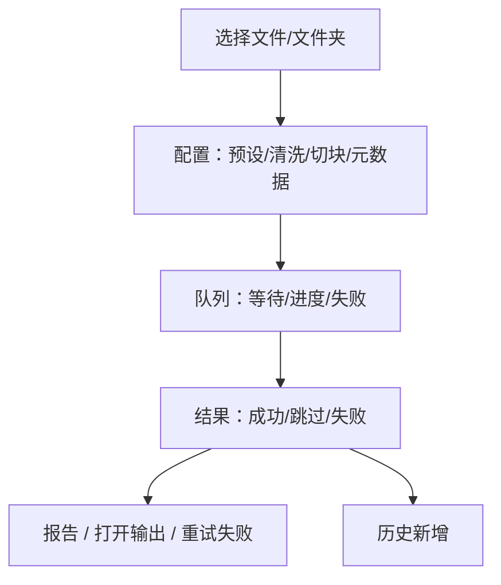

### 4.4 历史页面

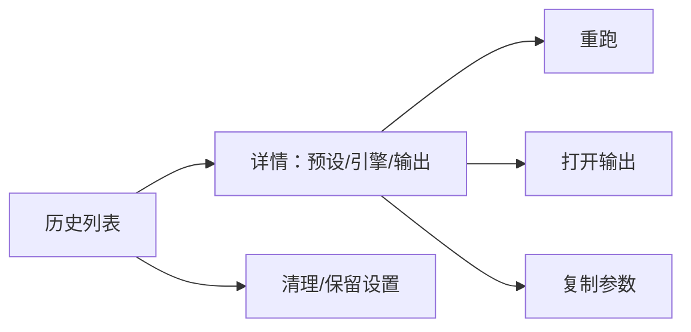

### 4.5 设置页面

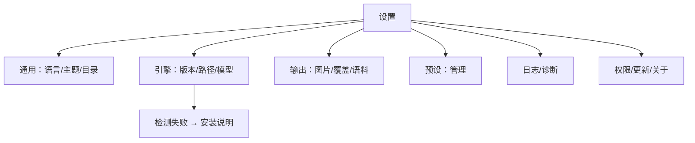

---

## 5. 业务流程

### 5.1 日常单文件转换


**价值**：不再开终端、不再上传在线服务；失败时知道原因（REQ-010~028）。

### 5.2 批量知识库构建


**价值**：把「转、洗、切、打包」串成一次操作；产物厂商中立（REQ-030~058）。

### 5.3 失败复盘


**价值**：失败可定位、可复现；不是「红色感叹号」（REQ-019/061）。

### 5.4 引擎安装与升级

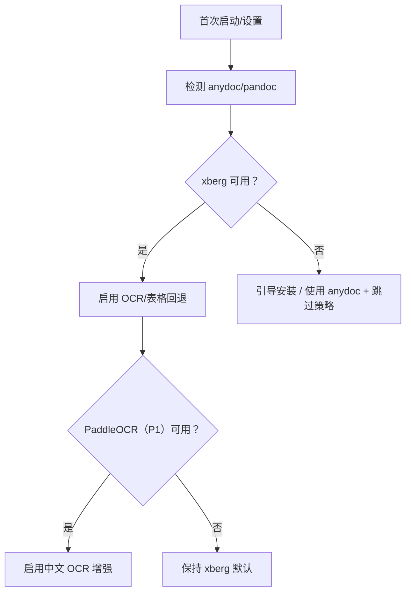

**价值**：引擎可选、可解释；不静默下载模型（REQ-071/099/101/102）。

### 5.5 预设复用


---

## 6. 数据流转

### 6.1 数据流总图

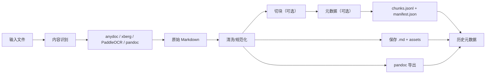

### 6.2 文件与目录

- 单文件：`<输出根>/<文件名>.md` + `assets/<文件名>/`。
- 批量：镜像相对路径；`corpus/chunks.jsonl` + `corpus/manifest.json`。
- 临时文件：应用数据目录；任务结束清理。
- 应用数据：`~/.dull_doc/`（`settings.json`、`presets.json`、`history.json`、`logs/`、`tmp/`）；用户输出目录独立。
- 不引入数据库；若后续引入 SQLite，补写《数据库设计说明》并更新 PRD 6.4。

### 6.3 任务状态机

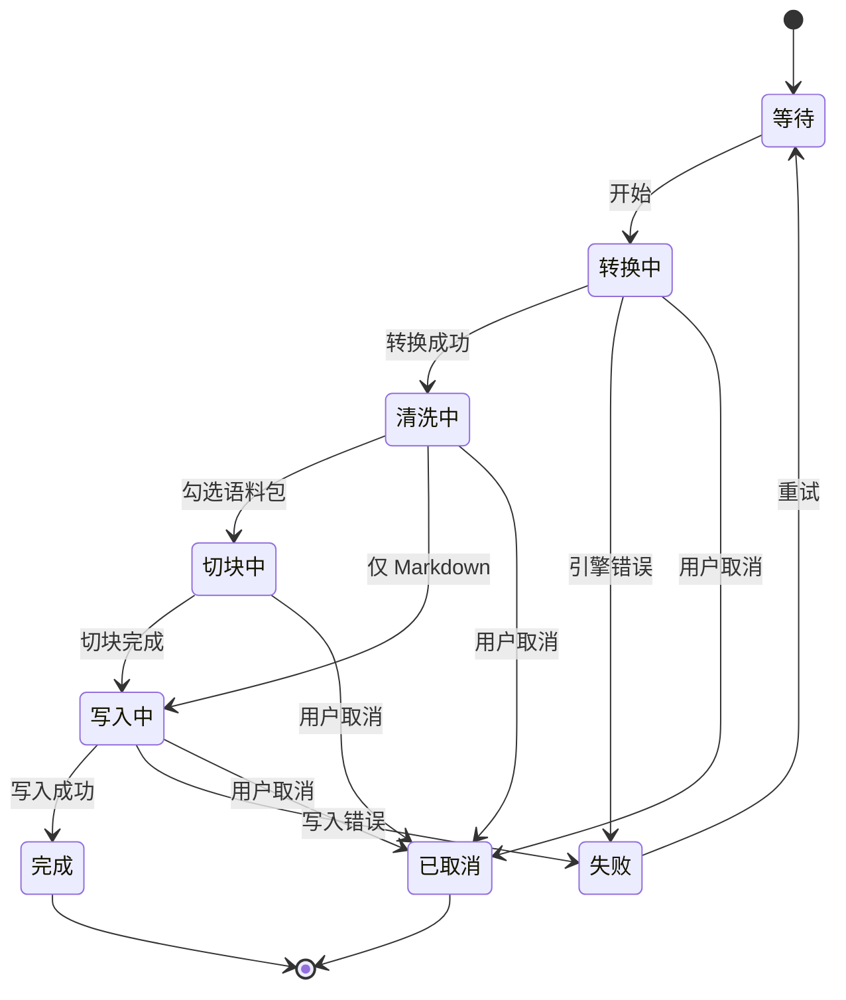

### 6.4 设置、预设与历史

| 数据 | 存储 | 关键字段 | 对应需求 |
| --- | --- | --- | --- |
| 设置 | `~/.dull_doc/settings.json` | 输出目录、并发、图片模式、覆盖策略、语言、日志级别 | REQ-005/070/072/074 |
| 预设 | `~/.dull_doc/presets.json` | 清洗开关、切块参数、元数据、PDF 策略 | REQ-073 |
| 历史 | `~/.dull_doc/history.json` | 时间、类型、输入数、状态、输出目录、预设快照、引擎版本 | REQ-060/061/062 |

### 6.5 manifest 与 chunks

- `manifest.json`：工具版本、预设快照、输入哈希、文件列表、`engine`、`ocr_engine`、`ocr_pages`、`skipped_pages`、警告、总计（REQ-054）。
- `chunks.jsonl`：每行 `{id,text,metadata}`；元数据含来源、章节、页码、hash、引擎与参数（REQ-052/053）。
- 输出后校验 JSONL、manifest、图片引用与空块（REQ-058）。

### 6.6 日志与诊断

- 字段：时间、任务 ID、文件 ID、阶段、引擎、耗时、错误码、警告；不记录文件正文与密钥（REQ-006/074/082）。
- 诊断包：设置快照 + 引擎版本 + 错误摘要；用户显式导出（REQ-006）。
- 日志分级：error/warn/info/debug；默认 info。

### 6.7 隐私边界

- 默认零网络请求（REQ-007/080）。
- 只读用户选择的输入，只写输出目录（REQ-083）。
- 未来云 OCR/API key：系统钥匙串 + 显式开启 + 二次确认（REQ-082）。
- 诊断包导出前脱敏路径与文件名（REQ-074）。

---

## 7. 组件与 SDK 设计

### 7.1 UI 公用组件

| 组件 | 用途 | 关键状态 | 对应需求 |
| --- | --- | --- | --- |
| Button | 主/次/危险操作 | default/hover/active/disabled/loading | REQ-002/018 |
| Input | 路径/搜索/参数 | default/focus/error/disabled | REQ-070~076 |
| Select | 预设/引擎/策略 | default/open/disabled | REQ-017/071 |
| Switch | 清洗规则/开关 | on/off/disabled | REQ-040 |
| Card | 文件/任务/结果 | default/hover/selected | REQ-032/036 |
| Table | 队列/历史/矩阵 | default/empty/loading/error | REQ-032/060 |
| Progress | 单文件/批量 | determinate/indeterminate/error | REQ-018/034 |
| Dialog | 确认/错误/PDF 页 | open/close/loading | REQ-015/019 |
| EmptyState | 空目录/无历史 | default | REQ-010/060 |
| ErrorState | 失败/无权限 | message/action | REQ-019/075 |
| Toast | 完成/失败通知 | success/error/info | REQ-004 |

### 7.2 Core SDK 模块

| 模块 | 职责 | 关键接口 | 对应需求 |
| --- | --- | --- | --- |
| `engine_router` | 格式识别、引擎选择、回退 | `route(path) -> EnginePlan` | REQ-011/013/016/098 |
| `converter` | 调用 anydoc/xberg/PaddleOCR/pandoc | `convert(plan) -> Markdown` | REQ-013/097/101 |
| `pdf_preflight` | 页级文本检测、临时 PDF | `inspect(pdf) -> PdfReport` | REQ-014/015 |
| `cleaner` | 清洗与中文规范化 | `clean(md, rules) -> md` | REQ-040~047 |
| `chunker` | 切块、父子块、重叠 | `chunk(md, cfg) -> Chunk[]` | REQ-050/051 |
| `manifest` | manifest/chunks 生成与校验 | `write(manifest)`, `validate()` | REQ-053/054/058 |
| `history` | 历史读写、重跑 | `list()`, `add()`, `rerun()` | REQ-060~062 |
| `settings` | 设置/预设读写 | `load()`, `save()`, `presets()` | REQ-005/073 |
| `logger` | 结构化日志、诊断包 | `log(event)`, `export_diagnostics()` | REQ-006/074 |
| `error` | 错误码与用户文案 | `AppError -> UserMessage` | REQ-019 |

### 7.3 Tauri Commands / Events

| 类型 | 名称 | 入参 | 出参 | 对应需求 |
| --- | --- | --- | --- | --- |
| Command | `pick_files` | 无 | 路径列表 | REQ-010/030 |
| Command | `inspect_file` | 路径 | 格式/信息/预检 | REQ-011/012/014 |
| Command | `convert_file` | 路径 + 预设 | 任务 ID / Markdown | REQ-013/017 |
| Command | `cancel_task` | 任务 ID | 成功/失败 | REQ-018/034 |
| Command | `start_batch` | 路径列表 + 预设 | 批次 ID | REQ-031~033 |
| Command | `retry_file` | 任务 ID + 文件 ID | 新任务 | REQ-035 |
| Command | `export_document` | Markdown + 格式 | 输出路径 | REQ-024~026 |
| Command | `get_history` | 分页 | 历史列表 | REQ-060 |
| Command | `rerun_history` | 历史 ID | 新任务 | REQ-061 |
| Command | `get_settings` / `save_settings` | 设置对象 | 设置对象 | REQ-005/070 |
| Command | `export_diagnostics` | 无 | 诊断包路径 | REQ-006 |
| Event | `task://progress` | 任务 ID/阶段/进度 | — | REQ-018/034 |
| Event | `task://warning` | 文件/警告 | — | REQ-015/045 |
| Event | `task://done` | 任务 ID/结果 | — | REQ-004/036 |

### 7.4 Engine 接口（Rust）

```rust
/// 所有解析引擎实现同一接口，便于插件化与质量对比。
pub trait Engine {
    fn name(&self) -> &'static str;
    fn version(&self) -> &'static str;
    fn supports(&self, format: Format) -> bool;
    fn convert(&self, input: &Input, opts: &ConvertOptions) -> Result<Markdown, EngineError>;
}
```

- `EnginePlan` 记录主引擎、OCR 引擎、回退原因；写入 manifest（REQ-054/098）。
- 外部 sidecar 用参数数组调用，设置超时与取消（REQ-081）。
- 引擎不可用时返回结构化错误，由 UI 展示安装说明（REQ-099/101）。

---

## 8. 状态、错误与日志设计

### 8.1 任务状态

见 6.3 状态机。所有状态转换写入日志；取消与失败都要清理临时文件（REQ-018/034）。

### 8.2 错误处理

统一错误码（PRD 6.6）：`E_FORMAT_UNSUPPORTED`、`E_ENCRYPTED`、`E_CORRUPTED`、`E_NEEDS_OCR`、`E_PDF_IMAGE_PAGES`、`E_ENGINE_FAILED`、`E_OUTPUT_WRITE`、`E_CANCELLED`、`E_RESOURCE_LIMIT`。每个错误包含：文件、页（可选）、引擎、原因、下一步、可复制诊断（REQ-019）。

### 8.3 重试策略

| 类型 | 策略 |
| --- | --- |
| 可重试（临时 IO、引擎超时） | 自动重试 1 次；仍失败则提示 |
| 需用户（加密、无权限、扫描件） | 不自动重试；展示下一步 |
| 不可恢复（损坏、格式不支持） | 标记失败；保留诊断 |
| 批量 | 单文件重试不阻塞队列；失败汇总 |

### 8.4 日志字段

`timestamp`、`level`、`task_id`、`file_id`、`stage`、`engine`、`engine_version`、`duration_ms`、`error_code`、`warning`、`preset`。不记录正文、路径可脱敏（REQ-006/074/082）。

---

## 9. 需求追溯矩阵

> 本矩阵覆盖 PRD 中 82 条 REQ 与 12 条 NFR。模块/功能列对应第 2 节，流程列对应第 3~6 节。

### 9.1 全局与转换

| REQ | 优先级 | 模块 / 功能 | 流程 | 验证点 |
| --- | --- | --- | --- | --- |
| REQ-001 | P0 | 全局/主窗口 | 页面-启动 | 启动 < 3s，无白屏 |
| REQ-002 | P0 | 全局/侧边栏 | 页面-导航 | 四页切换与快捷键 |
| REQ-003 | P0 | 全局/拖入 | 页面-导航 | 单/多/文件夹路由 |
| REQ-004 | P0 | 全局/任务状态 | 功能-单文件 | 切页不丢状态 |
| REQ-005 | P0 | 全局/设置持久化 | 数据-设置 | 重启恢复 |
| REQ-006 | P0 | 全局/日志诊断 | 数据-日志 | 诊断包脱敏 |
| REQ-007 | P0 | 全局/离线 | 业务-离线 | 断网全流程 |
| REQ-008 | P0 | 全局/关于 | 页面-设置 | 许可完整 |
| REQ-010 | P0 | 转换/文件选择 | 功能-单文件 | 文件信息正确 |
| REQ-011 | P0 | 转换/内容识别 | 功能-单文件 | 改扩展名仍识别 |
| REQ-012 | P0 | 转换/文件信息 | 页面-单文件 | 页数/引擎正确 |
| REQ-013 | P0 | 转换/anydoc | 功能-单文件 | docx/xlsx 成功 |
| REQ-014 | P0 | 转换/PDF 预检 | 功能-PDF | 第 1 页识别 |
| REQ-015 | P0 | 转换/无文本页策略 | 功能-PDF | skip/fail/ask |
| REQ-016 | P0 | 转换/OCR 路由 | 功能-PDF | xberg/PaddleOCR/降级 |
| REQ-017 | P0 | 转换/选项 | 页面-单文件 | 预设/图片/公式 |
| REQ-018 | P0 | 转换/进度取消 | 功能-单文件 | 取消清理 |
| REQ-019 | P0 | 转换/错误重试 | 功能-失败 | 错误码/下一步 |
| REQ-020 | P0 | 预览/渲染 | 页面-单文件 | GFM 渲染 |
| REQ-021 | P0 | 预览/源码 | 页面-单文件 | 与保存一致 |
| REQ-022 | P1 | 预览/质量提示 | 功能-质量 | 问题可定位 |
| REQ-023 | P0 | 保存/md+assets | 功能-保存 | 移动目录仍显示 |
| REQ-024 | P0 | 导出/HTML | 功能-导出 | md → HTML |
| REQ-025 | P0 | 导出/DOCX | 功能-导出 | md → DOCX |
| REQ-026 | P0 | 导出/EPUB | 功能-导出 | md → EPUB |
| REQ-027 | P0 | 操作/打开复制 | 页面-结果 | Finder/复制 |
| REQ-028 | P0 | 导出/检查 | 功能-导出 | 缺失阻塞 |

### 9.2 批量、清洗与语料包

| REQ | 优先级 | 模块 / 功能 | 流程 | 验证点 |
| --- | --- | --- | --- | --- |
| REQ-030 | P0 | 批量/输入 | 功能-批量 | 多选/文件夹 |
| REQ-031 | P0 | 批量/递归过滤 | 功能-批量 | 不自我递归 |
| REQ-032 | P0 | 批量/队列 | 页面-批量 | 状态准确 |
| REQ-033 | P0 | 批量/并发 | 功能-批量 | 1–8 可配 |
| REQ-034 | P0 | 批量/进度取消 | 功能-批量 | 取消清理 |
| REQ-035 | P0 | 批量/重试跳过 | 功能-失败 | 已存在策略 |
| REQ-036 | P0 | 批量/结果报告 | 页面-批量 | JSON/CSV |
| REQ-037 | P1 | 批量/监听 | 业务-自动化 | 5s 入队 |
| REQ-038 | P1 | 批量/CLI | 业务-自动化 | 与 GUI 一致 |
| REQ-039 | P0 | 批量/预设 | 页面-批量 | 预设生效 |
| REQ-040 | P0 | 清洗/开关 | 功能-清洗 | 关规则回原始 |
| REQ-041 | P0 | 清洗/页眉页脚 | 功能-清洗 | 页码消失 |
| REQ-042 | P0 | 清洗/断行空段 | 功能-清洗 | 代码不变 |
| REQ-043 | P0 | 清洗/标题编号 | 功能-清洗 | `5.1` 规范 |
| REQ-044 | P0 | 清洗/中文 | 功能-清洗 | CJK 不拆 |
| REQ-045 | P0 | 清洗/表格分级 | 功能-清洗 | A/B/C |
| REQ-046 | P0 | 清洗/图片资产 | 功能-清洗 | 路径可移植 |
| REQ-047 | P0 | 清洗/TOC | 功能-清洗 | 目录不污染 |
| REQ-048 | P1 | 清洗/对比 | 页面-预览 | 差异可见 |
| REQ-050 | P0 | 语料/切块 | 功能-语料包 | 标题切/超长切 |
| REQ-051 | P0 | 语料/表格整块 | 功能-语料包 | 表格不拆 |
| REQ-052 | P0 | 语料/元数据 | 数据-语料包 | 最小字段集 |
| REQ-053 | P0 | 语料/chunks | 数据-语料包 | 每行可解析 |
| REQ-054 | P0 | 语料/manifest | 数据-语料包 | 哈希/引擎/警告 |
| REQ-055 | P0 | 语料/输出打包 | 功能-语料包 | 目录/zip |
| REQ-056 | P1 | 语料/去重 token | 功能-语料包 | 统计准确 |
| REQ-057 | P2 | 语料/平台适配 | 数据-语料包 | 中立 JSONL |
| REQ-058 | P0 | 语料/校验 | 功能-语料包 | 失败可定位 |

### 9.3 历史、设置与安全

| REQ | 优先级 | 模块 / 功能 | 流程 | 验证点 |
| --- | --- | --- | --- | --- |
| REQ-060 | P0 | 历史/列表 | 页面-历史 | 50 条/重启保留 |
| REQ-061 | P0 | 历史/详情重跑 | 业务-失败复盘 | 同预设重跑 |
| REQ-062 | P0 | 历史/清理 | 页面-历史 | 不删输出 |
| REQ-070 | P0 | 设置/通用 | 页面-设置 | 语言/主题/目录 |
| REQ-071 | P0 | 设置/引擎 | 页面-设置 | 版本/路径/模型 |
| REQ-072 | P0 | 设置/输出 | 页面-设置 | 图片/覆盖/语料 |
| REQ-073 | P0 | 设置/预设 | 页面-设置 | 导入导出 |
| REQ-074 | P0 | 设置/日志 | 数据-日志 | 脱敏/诊断 |
| REQ-075 | P0 | 设置/权限 | 页面-设置 | 书签持久 |
| REQ-076 | P1 | 设置/更新 | 页面-设置 | 默认不联网 |
| REQ-080 | P0 | 安全/无遥测 | 业务-离线 | 抓包 0 请求 |
| REQ-081 | P0 | 安全/命令 | 架构/引擎调用 | 注入用例通过 |
| REQ-082 | P0 | 安全/密钥脱敏 | 数据-隐私 | 日志无密钥 |
| REQ-083 | P0 | 安全/文件边界 | 数据-隐私 | 不越权 |

### 9.4 多引擎与 P1/P2

| REQ | 优先级 | 模块 / 功能 | 流程 | 验证点 |
| --- | --- | --- | --- | --- |
| REQ-090 | P1 | 引擎/Marker/MinerU | 功能-OCR | 引导安装 |
| REQ-091 | P1 | 导出/PDF | 功能-导出 | Typst/WebView |
| REQ-092 | P1 | 引擎/插件化 | 架构/Engine trait | 可切换 |
| REQ-093 | P1 | 自动化/Finder | 业务-自动化 | 右键入口 |
| REQ-094 | P2 | 平台/Windows/Linux | 架构 | 后续 |
| REQ-095 | P2 | 集成/平台 | 数据-语料包 | 中立输出 |
| REQ-096 | P2 | 表格/修复增强 | 功能-清洗 | 专项 |
| REQ-097 | P0 | 引擎/xberg | 功能-OCR | 扫描页成功 |
| REQ-098 | P0 | 引擎/路由回退 | 功能-OCR | 原因可见 |
| REQ-099 | P0 | 引擎/模型管理 | 业务-引擎安装 | 不静默下载 |
| REQ-100 | P1 | 引擎/质量对比 | 功能-质量 | 报告可导出 |
| REQ-101 | P1 | 引擎/PaddleOCR | 功能-OCR | 中文页识别 |
| REQ-102 | P1 | 引擎/OCR 选择 | 功能-OCR | 选择持久化 |

### 9.5 NFR 追溯

| NFR | 设计落点 | 验证 |
| --- | --- | --- |
| NFR-001 性能 | 6.3 状态机、7.2 converter、并发控制 | 50 页文本 PDF < 10s；xberg OCR < 120s |
| NFR-002 可靠性 | 3.6 失败处理、6.3 状态机 | 批量 50 文件无崩溃 |
| NFR-003 安全 | 2.10/7.4 参数数组、超时、取消 | 注入用例 |
| NFR-004 隐私 | 6.7 隐私边界 | 抓包 0 请求 |
| NFR-005 可复现 | 6.5 manifest、7.2 manifest | 同输入同预设一致 |
| NFR-006 可维护 | 7.1/7.2 组件与 SDK | 组件复用 |
| NFR-007 可访问性 | 7.1 组件状态 | 键盘/对比度 |
| NFR-008 本地化 | 7.1 文案与组件 | 中文无截断 |
| NFR-009 打包 | 1.3 架构、sidecar | 公证 |
| NFR-010 兼容 | 1.3 架构 | macOS 13+ |
| NFR-011 日志 | 6.6 日志字段 | 失败可定位 |
| NFR-012 许可 | 关于页/引擎清单 | 许可一致 |

---

## 10. 排期与里程碑

### 10.1 优先级汇总

| 优先级 | 需求范围 | 说明 |
| --- | --- | --- |
| P0 | REQ-001~019、REQ-020~021、REQ-023~028、REQ-030~036、REQ-039~047、REQ-050~055、REQ-058、REQ-060~062、REQ-070~075、REQ-080~083、REQ-097~099 | MVP 必须 |
| P1 | REQ-022、REQ-037~038、REQ-048、REQ-056、REQ-076、REQ-090~093、REQ-100~102 | 紧随其后 |
| P2 | REQ-057、REQ-094~096 | 后续 |

### 10.2 里程碑

| 里程碑 | 交付 | 对应需求 |
| --- | --- | --- |
| M0 骨架 | Tauri 2 壳、四页导航、设置持久化、日志 | REQ-001~008 |
| M1 单文件 | anydoc、预览、保存、pandoc 导出 | REQ-010~028 |
| M2 OCR 回退 | PDF 预检、xberg、PaddleOCR 接口、manifest | REQ-014~016、097~102 |
| M3 批量 | 队列、并发、失败重试、报告 | REQ-030~039 |
| M4 清洗 | 页眉页脚、中文、标题、表格分级 | REQ-040~047 |
| M5 语料包 | 切块、元数据、chunks、manifest、校验 | REQ-050~058 |
| M6 收尾 | 历史、设置、诊断、验收 | REQ-060~075、080~083 |

### 10.3 MVP 验收

- `example/` 四个文件：docx、xlsx、PDF、md 全部通过。
- 50 页 PDF 预检 + OCR 回退成功；manifest 记录 `ocr_engine` / `ocr_pages`。
- 批量 50 文件无崩溃；失败可定位。
- 语料包 JSONL/manifest 校验通过。
- 断网全流程。
- 界面 100% 还原 S5 原型。

---

## 11. 风险与待确认

| 风险 / 待确认 | 影响 | 设计应对 |
| --- | --- | --- |
| xberg 体积/稳定性 | P0 依赖可能拖慢或增大安装包 | M2 前做 S6 技术验证；不可行降级 P1，回退 anydoc + skip |
| PaddleOCR macOS 依赖 | Python/Paddle 模型，CPU 慢 | P1 可选；只在低置信度启用；引导安装 |
| PDF 表格质量 | 复杂表格无法保证 A 级 | 质量分级 + 警告；不承诺 100% |
| 中文清洗误伤 | 英文/代码/URL | 分域规则 + 预览 + 开关 |
| UI 原型未定 | 组件与布局可能调整 | S5 先定设计规范；组件接口保持稳定 |
| 技术选型未定 | Tauri 2 具体插件、sidecar 方式 | S6 决定；本文档只约束接口与行为 |

---

## 12. 变更记录

| 版本 | 日期 | 变更 | 作者 |
| --- | --- | --- | --- |
| v0.1 | 2026-11-18 | 初稿：模块/功能拆解、6 个功能流程、5 个页面流程、5 个业务流程、数据流转、组件/SDK、状态/错误/日志、82 条 REQ + 12 条 NFR 追溯、里程碑 | Agent |
| v1.0 | 2026-11-18 | 用户确认 S4；状态改为「已确认」，进入 S5 | 用户 / Agent |

---

> **下一步**：S5 先写 UI 设计规范 / 设计系统，再做 HTML 高保真原型；UI 经用户确认后才进入编码。
